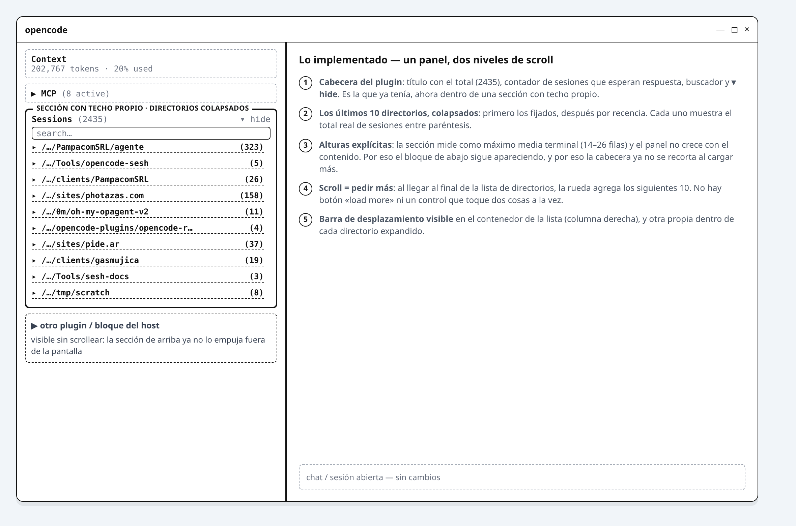
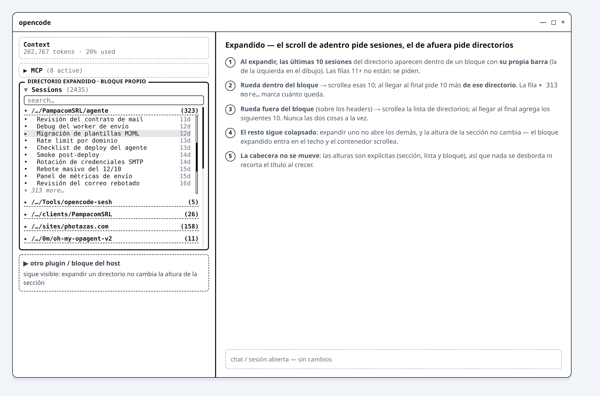
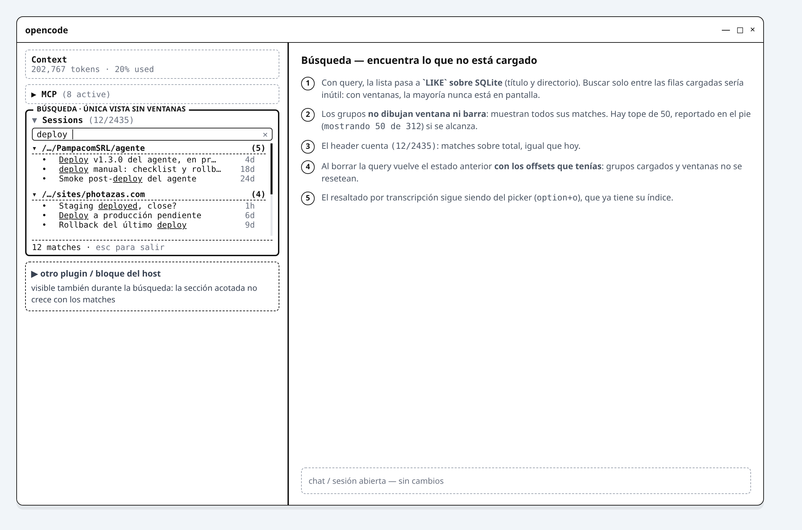
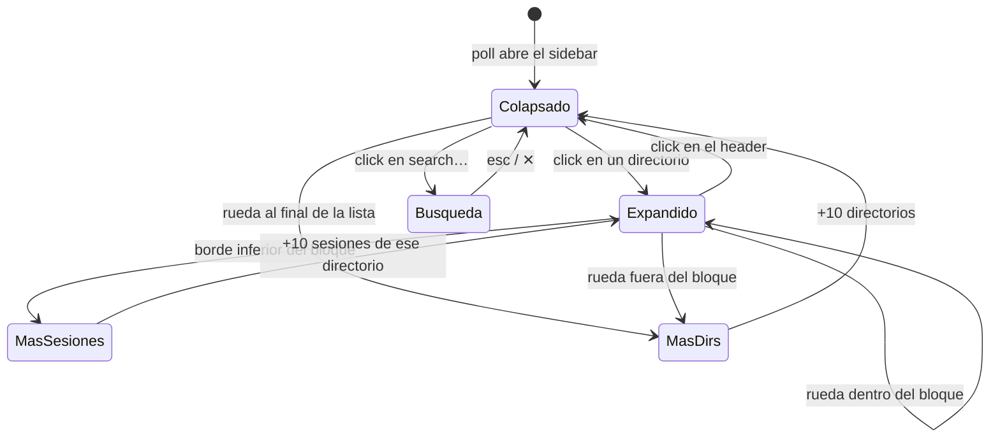

# Sidebar de sesh — espacio propio y dos niveles de scroll

| | Estado |
|---|---|
| Sección con techo propio, directorios colapsados, scroll que agrega de a un nivel | **implementada** |
| Lectura paginada contra SQLite (`LIMIT/OFFSET`) en lugar de paginar la API cada 15 s | **pendiente** — hoy el poll ya trae todo el store a memoria, así que el autoload recorta filas pintadas, no requests |

Bocetos en `docs/mockups/`: el HTML es la fuente versionable, el PNG es derivado
(`~/.agents/skills/wireframe-boceto/scripts/render-mockups.sh docs/mockups`).

## Reglas

| Pieza | Regla |
|---|---|
| Cabecera | Estilo del host (MCP): **▼/▶** + `Sessions` en negrita + total tenue; el triángulo colapsa la sección y el título activa la navegación por teclado. Debajo, el buscador |
| Filas | Bullet `•` (● la abierta, spinner la que corre, ▸ el cursor), título y edad tenue a la derecha — sin líneas de árbol |
| Texto largo | Sesiones **y** directorios: en reposo truncados con `…`; con el mouse encima (o el cursor de teclado en una sesión), **marquesina a la velocidad del host** (1 celda cada 80 ms tras 600 ms, un pase, gap `" · "`) |
| Colapsar | Un click explícito manda: sin click, needs-input arranca abierto y una búsqueda abre todos los grupos — el header sigue colapsando con query activa |
| Con filtro | La fila en reposo **revela el match** (`matchReveal`: corta la cabeza y la marca con `…`), así la palabra resaltada se ve sin hover; el hover sigue scrolleando el label completo |
| Alturas | **Explícitas** en todos los niveles (sección, lista, bloque de grupo). La sección mide como máximo media terminal (14–26 filas) y nunca crece con el contenido |
| Directorios | Los últimos `SIDEBAR_DIR_CHUNK` (10), **colapsados**; primero fijados, después por recencia |
| Sesiones | Al expandir, las últimas `SIDEBAR_SESSION_CHUNK` (10) dentro de un bloque con `SIDEBAR_GROUP_ROWS` (10) filas y barra propia |
| Autoload | La rueda al final de **cada nivel** agrega 10 de ese nivel; nunca las dos cosas a la vez |
| Scrollbars | Visibles: la del contenedor de la lista y la de cada directorio expandido |
| Búsqueda | Abre todos los grupos y lista todos los matches (sin chunks), porque el query ya acotó el conjunto |

## Por qué las alturas son explícitas

El slot del sidebar entrega al panel **altura ilimitada**. Con alturas implícitas la
sección crecía con su contenido: se llevaba toda la columna y dejaba inalcanzable
cualquier bloque debajo (otro plugin). Peor: un `maxHeight` dependiente del contenido
lo ignora Yoga, y el desborde se recortaba **por arriba** — al pedir “load more” la
cabecera desaparecía.

La lección quedó como regla: cada caja del sidebar (sección, lista, bloque de grupo)
recibe un `height` calculado; el contenido se recorta dentro del scrollbox y nunca
empuja al padre.

## Estados del boceto

### 1. Directorios colapsados (estado inicial)

10 directorios con su total entre paréntesis, bloque siguiente visible abajo.

### 2. Expandido

Las últimas 10 sesiones en un bloque con barra propia, la fila `▾ 313 more…` y la
rueda que pide 10 más de ese directorio sin tocar la lista de directorios.

### 3. Búsqueda

`LIKE` sobre SQLite (pendiente) o filtro en memoria (hoy), grupos abiertos y todos los
matches listados.

## Flujo de carga

